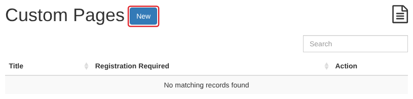
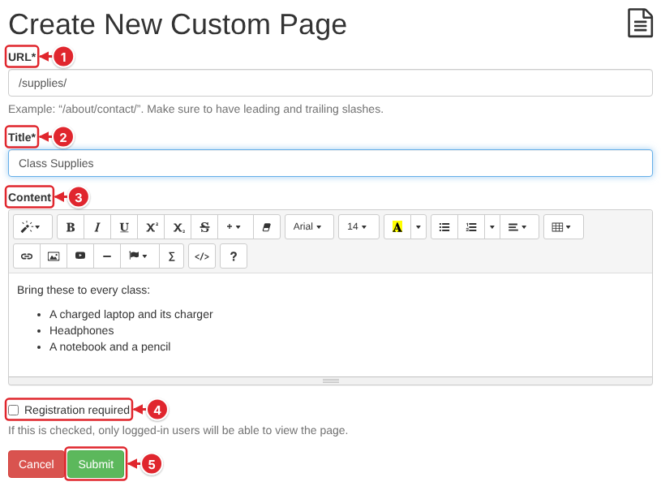
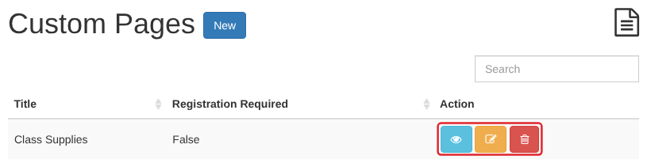
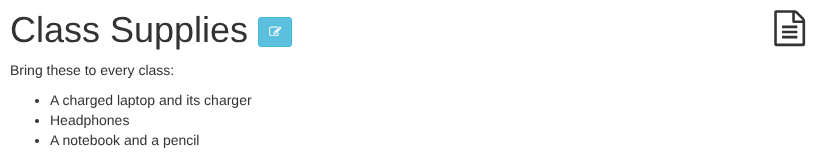
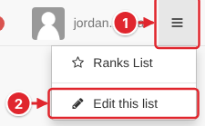
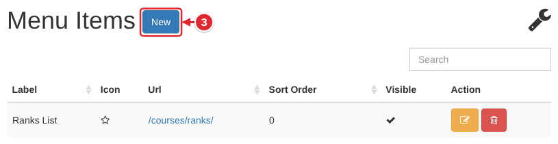
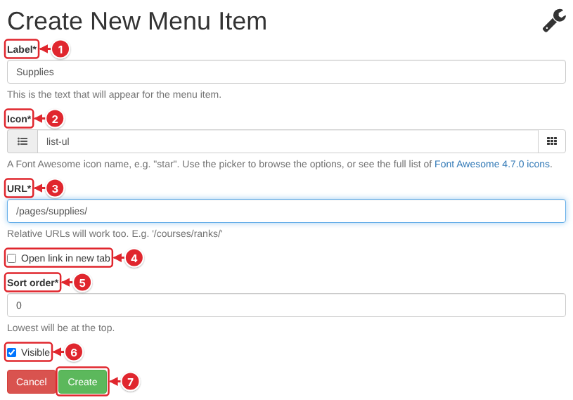
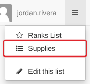

# Custom pages and links

A **custom page** is a page of your own on your deck: class expectations, a supply list, a course outline, help for a tricky piece of software. Link to it from a quest or an announcement, or add it to the deck's **Links** menu so it's always one click away.

## Create a page

Open **Admin > Pages** (under **Custom Pages**) to see your deck's pages, and press **New**. (**Admin > Create Page** goes straight to the form.)

/// caption
The Custom Pages list on a new deck, which has none yet.
///

Then fill in the page:

/// caption
A page of class supplies, ready to save.
///

1. **URL**: the page's address on your deck, with a slash at each end. `/supplies/` gives you `yourdeck.bytedeck.com/pages/supplies/`.
2. **Title**: the heading at the top of the page.
3. **Content**: anything you like, in the same editor as quests: text, lists, images, videos and links.
4. **Registration required**: tick it to show the page only to people signed in to your deck. Leave it unticked and anyone with the link can read it, which suits a page you share with parents.
5. **Submit** saves the page.

The page joins the list, with buttons to view, edit or delete it:

/// caption
The new page in the Custom Pages list.
///

/// caption
The page as your students see it. Teachers also get the edit button beside the title.
///

## Add it to the Links menu

The **☰** menu at the top right of every page (**Links** on a phone) holds your deck's handy links. A new deck has one, **Ranks List**. To add your page:

/// caption
The Links menu on a new deck, as a teacher sees it.
///

/// caption
The Menu Items page, listing the links in the menu.
///

1. Open the **☰** menu.
2. Choose **Edit this list** (teachers only).
3. Press **New**, and fill in the link:

/// caption
A link to the Class Supplies page, ready to save.
///

1. **Label**: the words in the menu.
2. **Icon**: the small picture beside them. Press the button at the end of the field to browse the icons, or type an icon's name.
3. **URL**: where it goes: a page on your deck, such as `/pages/supplies/`, or any other website (`https://...`). For a page on your deck, ByteDeck refuses an address it has no pages at, such as a typo like `/pagess/supplies/`. It doesn't check that the page itself exists, so try the link once it's saved.
4. **Open link in new tab**: handy for links to other websites.
5. **Sort order**: the menu lists its links from the lowest number down.
6. **Visible**: untick it to hide a link without deleting it.
7. **Create** saves the link. It's in everyone's menu straight away:

/// caption
The Links menu with the new link.
///

The menu can hold links to anywhere, not just your custom pages: a quest everyone keeps looking for, your school's website, or a shared folder.
